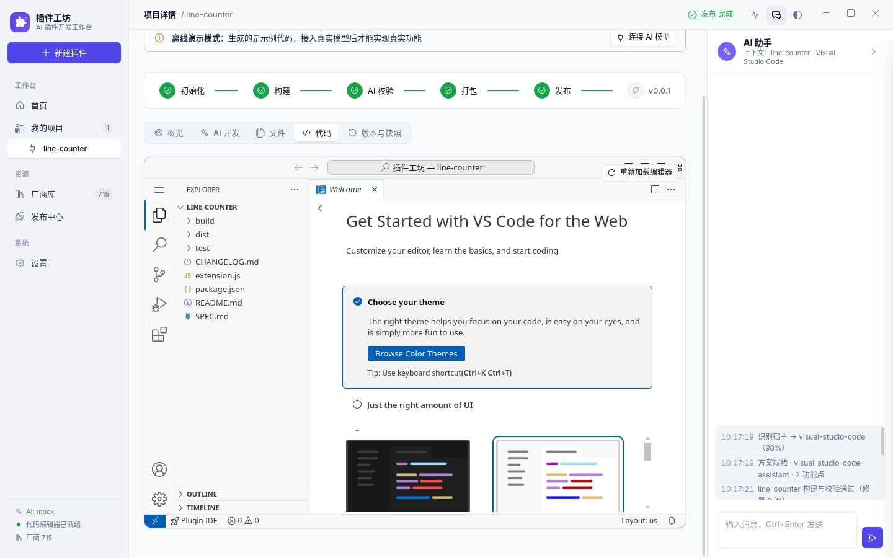
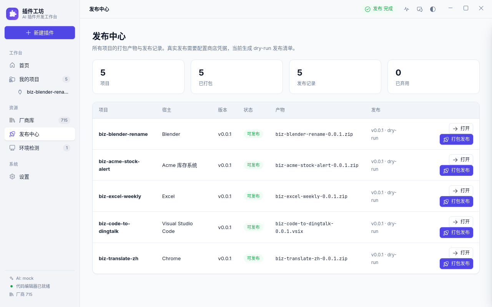

# PluginWorkbench

**1.3.0** · 插件研发工作台：从意图、计划、生成代码到发布，用智能体辅助开发浏览器、编辑器和其他平台插件。

## 界面截图


*首页 / Home*


*意图卡片 / Intent cards*



*代码编辑 / Code editor tab*



*发布中心 / Publish center*

## 功能特性

- 向导式流程：提示词 → 意图 → 计划（可编辑）→ 智能体运行 → 代码页 → 迭代 → 发布。
- 覆盖多种目标形态（例如浏览器翻译扩展、VS Code / 钉钉、Excel、库存、Blender 脚本等示例流程）。
- 安装向导、环境检测、检查点 diff、AI 向导与发布说明。

## 技术栈

- JavaScript / Electron（`src/plugin-ide`）

## 从源码运行

源码在 `src/plugin-ide/`。本仓库不包含安装包。

```bash
cd src/plugin-ide
npm install
# 按该目录 README 启动开发或桌面端
```

## 文档

- [源码 README](src/plugin-ide/README.md)

---

## English

# Plugin Workbench

**1.3.0** · A plugin development workbench: go from intent and plan through generated code to publish, with agents helping build browser, editor, and other plugins.

## Screenshots


*首页 / Home*


*意图卡片 / Intent cards*


*代码编辑 / Code editor tab*


*发布中心 / Publish center*

## Features

- Guided flow: prompt → intent → editable plan → agent run → code tab → iterate → ship.
- Example targets include browser extensions, VS Code / DingTalk, Excel, inventory tools, and Blender scripts.
- Install wizard, environment detection, checkpoint diffs, an AI wizard, and a publish center.

## Tech stack

- JavaScript / Electron（`src/plugin-ide`）

## Getting started

Source is under `src/plugin-ide/`. This repository does not include installers.

```bash
cd src/plugin-ide
npm install
# Start dev or desktop mode as that README describes
```

## Documentation

- [源码 README](src/plugin-ide/README.md)

